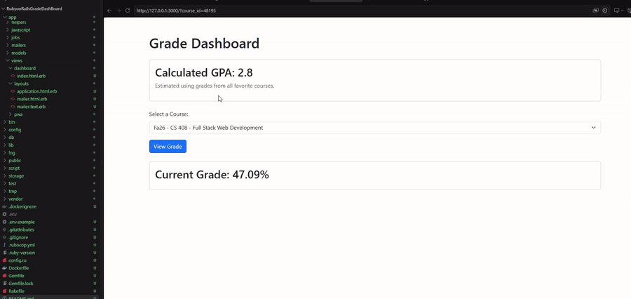

# Canvas Grade Dashboard

## Description
The Canvas Grade Dashboard allows you to select each course individually and see what your grade percentage is for each class.
It also allows you to view your estimated GPA is for the current courses which is automatically calculated for you.

## Demo

## Setup Instructions
1. Clone the repository:
   `git clone [YOUR REPO URL]`

2. Enter the project folder:
   `cd [PROJECT FOLDER]`

    Or use your IDE built in repo cloning features

3. Install dependencies:
   `bundle install`

4. Create a `.env` file.

5. Add your Canvas API token:
   `CANVAS_API_TOKEN=your_token_here`

6. Start the server:
   `rails server`

7. Open `http://127.0.0.1:3000`

## API Endpoints Used

Endpoint:
`/api/v1/users/self/favorites/courses`

Purpose:
This just gets your favorite courses, which allowed me to view my current
courses instead of all courses present and past.

Endpoint:
`/api/v1/courses/:id/enrollments`

Purpose:
Gets enrollment info including current grades

## Reflection

I learned from this project how to use API, more specifically with ruby on rails. Using the API I figured out how to get
certain information that I needed from canvas to help build my project. I also figured out how to get and create my API
token from canvas and use it in my .env file while keeping it hidden with git ignore.
The most challenging part was to get the correct information to display correctly. It took me a bit to figure out which endpoints
I need to display the information that I wanted, like the correct courses.
If I had more time I would probably add maybe an assignment viewer an what assignment grades and negatively affecting my grades.
I would also add a bit more style and color and make it look nicer.